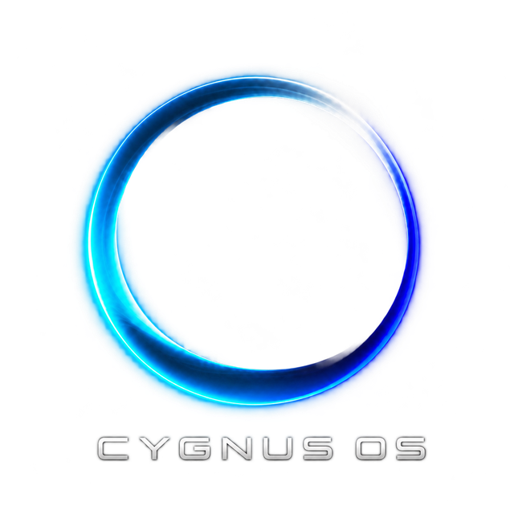
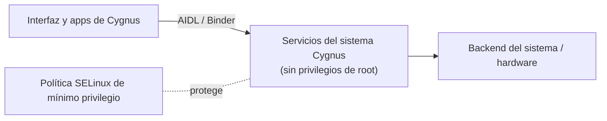

  

# Cygnus OS

**Sistema operativo móvil basado en Android (AOSP 13), desarrollado en Paraguay.**

[Sitio web](https://ashb-official.github.io/Cygnus_OS/) · [Pitch deck (PDF)](docs/Cygnus_OS_Pitch_Deck_2026.pdf) · [Licencia](LICENSE)

> **Estado:** en desarrollo activo. Beta pública prevista para **marzo de 2027** (imagen para emulador).
> Este repositorio es la presentación pública del proyecto. El código fuente de Cygnus OS es propietario y no se publica aquí.

---

## Qué es Cygnus OS

Cygnus OS es un sistema operativo móvil construido sobre AOSP con una capa propia de servicios del sistema, interfaz y aplicaciones. Su objetivo es ofrecer un sistema rápido, eficiente con la batería y respetuoso con la privacidad, con funciones propias integradas en el sistema y no como aplicaciones añadidas.

## Componentes principales

| Componente | Qué hace | Estado |
|---|---|---|
| **Control Center** | Panel central para ver y ajustar el rendimiento, la batería y los modos del sistema. | Validado en emulador |
| **Game Turbo** | Sesiones de juego con un perfil de rendimiento dedicado que se cierra solo al terminar el juego. | Validado en emulador |
| **Battery Guard** | Supervisión del estado de protección de la batería, integrada en el sistema. | Validado en emulador |
| **Quick Panel** | Panel de ajustes rápidos rediseñado. | Validado en emulador |
| **Clasificador de hardware** | Detecta la capacidad del equipo y adapta los perfiles del sistema. | Validado en emulador |
| **Touch & Connect** | Emparejamiento de dispositivos tocándolos entre sí. Hoy entre teléfonos; PC, relojes, auto y TV en el plan. | Base validada |
| **Quari Store** | Tienda de aplicaciones curada, con catálogo firmado y compatibilidad opcional con microG. | En desarrollo |
| **Asistente de bienvenida** | Configuración inicial del sistema con identidad Cygnus. | En desarrollo |

## Arquitectura (resumen)

Principios de diseño:

- **Servicios sin root:** cada servicio corre con la identidad mínima necesaria.
- **Permisos por firma:** solo los componentes autorizados del sistema acceden a cada servicio.
- **SELinux estricto:** política de mínimo privilegio, sin modos permisivos.
- **Nada a medias:** las funciones incompletas permanecen desactivadas hasta validarse.
- **Validación por etapas:** cada módulo pasa auditoría, compilación, pruebas en ejecución y congelado antes de considerarse terminado.

## Hoja de ruta

| Versión | Fecha prevista | Contenido |
|---|---|---|
| **Beta 1.0** | Marzo 2027 | Imagen para emulador con los componentes principales, tema Cygnus y Quari Store. |
| **1.1** | ~Mayo 2027 | Rediseño de la pantalla de bloqueo y las notificaciones; primer dispositivo físico (en evaluación). |
| **1.2** | ~Julio 2027 | Rediseño de recientes, volumen y menú de apagado. |
| **Después** | — | Task Space y Touch & Connect multidispositivo. |

## Inversionistas y socios

El código fuente está disponible para revisión técnica **bajo acuerdo de confidencialidad (NDA)**, junto con una demostración en vivo del sistema. Para solicitarlo, utiliza el contacto de la web del proyecto.

## Licencia

© 2026 Gabriel Alexander Sharp Brizuela. Todos los derechos reservados.

Cygnus OS se basa en el Android Open Source Project (AOSP). Los componentes de AOSP conservan sus licencias originales (Apache 2.0 y otras). Los componentes propios de Cygnus OS son propietarios.

---

### English summary

Cygnus OS is a mobile operating system built on AOSP 13, developed in Paraguay, with its own system services, interface and apps focused on performance, battery efficiency and privacy. It is under active development; the public beta (emulator image) is planned for March 2027. The source code is proprietary and available for technical review under NDA.
